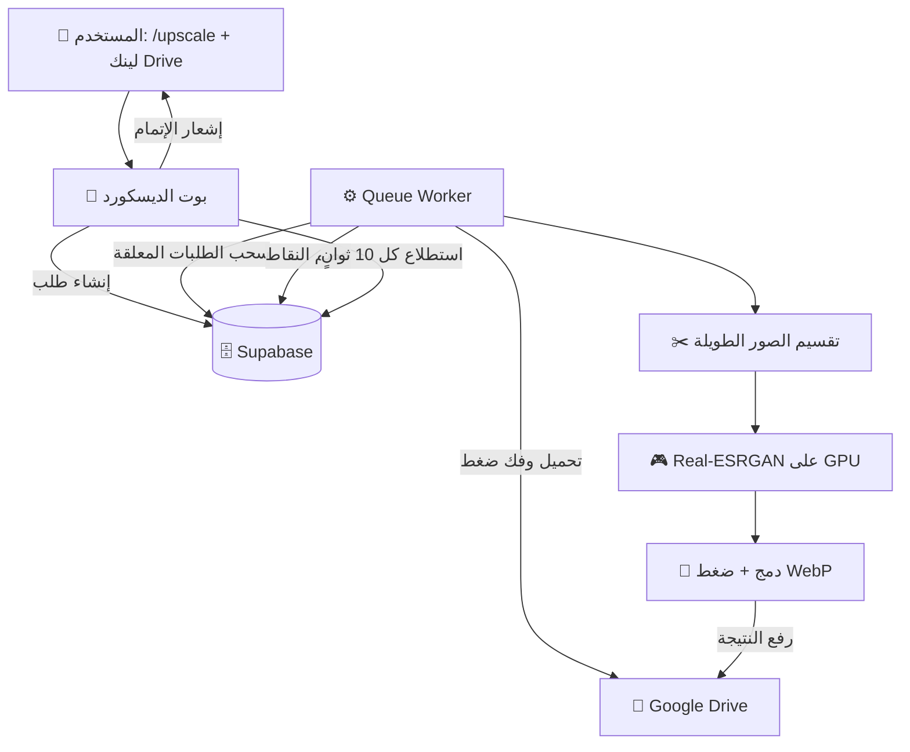
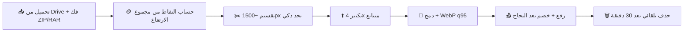
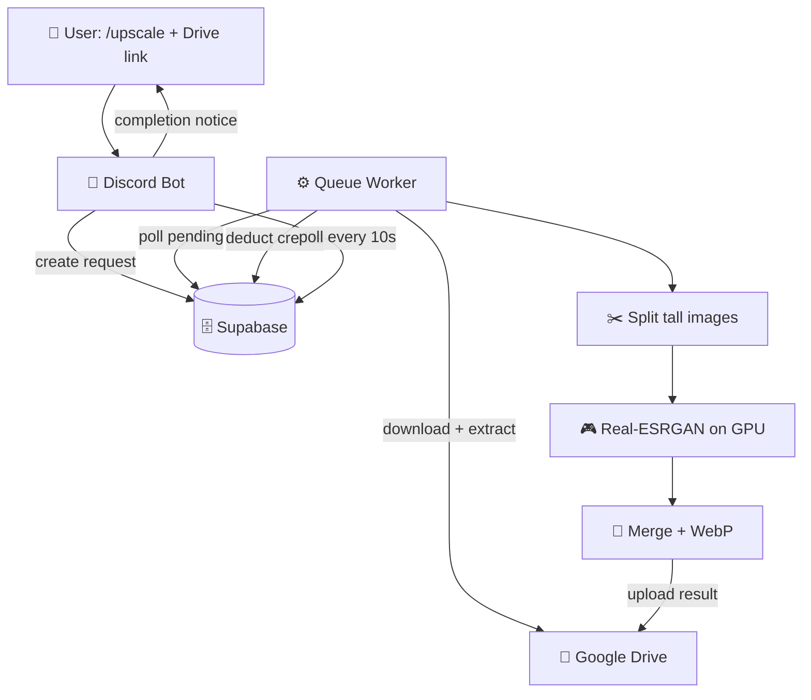
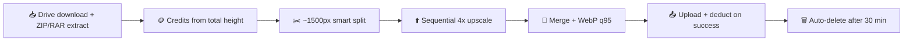

<div align="center">

# 🖼️ UPSCALE BOT

### تكبير صور المانهوا 4x بالذكاء الاصطناعي — AI 4x Manhwa Upscaler

[](./LICENSE)
[](https://www.python.org/)
[](https://fastapi.tiangolo.com/)
[](https://pytorch.org/)
[](https://github.com/xinntao/Real-ESRGAN)
[](https://discord.js.org/)
[](https://supabase.com/)

**بوت ديسكورد + سيرفر GPU: ابعت لينك مجلد Drive واستلم صورك مكبرة 4x بجودة الأنمي.**

**Discord bot + GPU server: send a Drive folder link, get your pages back upscaled 4x.**

</div>

---

<div align="center">

## 🌍 اختار اللغة — Choose Language

### [🇪🇬 العربية](#-النسخة-العربية) &nbsp;&nbsp;|&nbsp;&nbsp; [🇬🇧 English](#-english-version)

</div>

---

<a id="-النسخة-العربية"></a>

<div dir="rtl">

## 🇪🇬 النسخة العربية

### 📖 الفكرة

**Upscale Bot** منظومة تكبير صور الويبتون/المانهوا بموديلات **Real-ESRGAN** على كارت شاشة (مُجرب على RTX 3060 بذاكرة 12GB). المستخدم يبعت أمر `/upscale` مع لينك مجلد Google Drive، السيرفر يحمّل ويفك الضغط ويكبّر ويرفع النتيجة لمجلد جديد، والبوت يبلّغه — كله بنظام نقاط.

### 🏗️ المعمارية



### 🔄 خط المعالجة (Pipeline)



### ✨ المميزات

- 🤖 أوامر ديسكورد كاملة + إشعارات Embed غنية
- ✂️ تقسيم ذكي بتحليل تدرج الإضاءة (تسامح 100px)
- 🖼️ تجاوز حد WebP (16383px) بتقسيم تلقائي مرقم
- 🪙 نقاط عادلة حسب الحجم + 10 نقاط هدية للجدد
- 🧠 تنظيف ذاكرة عدواني (يناسب 12GB VRAM)
- 🐳 تشغيل تفاعلي بقائمة موديلات + Docker

### 🧠 جدول الموديلات

| الموديل | المعمارية | الحجم | السرعة | الجودة | الاستخدام |
|---|---|---|---|---|---|
| `RealESRGAN_x4plus_anime_6B` | RRDBNet ‏(6 كتل) | 17MB | متوسطة | **الأفضل** | أنمي/ويبتون (الافتراضي) |
| `realesr-animevideov3` | SRVGG مضغوط | 2.4MB | **سريع 5-10x** | جيدة | معاينة سريعة |
| `RealESRGAN_x4plus` | RRDBNet ‏(23 كتلة) | — | بطيء | جيدة | عام |
| `4x-AnimeSharp` | RRDBNet ‏(23 كتلة) | 29MB | بطيء | ممتازة للنصوص | نصوص وفقاعات الويبتون |
| `4x-UltraSharp` | RRDBNet ‏(23 كتلة) | 67MB | بطيء | حواف ممتازة | عام |
| `realesr-general-x4v3` | SRVGG ‏(32 كتلة) | 17MB | متوسطة | آمن للنصوص | إزالة تشويش 0.3 |

الاختيار من قائمة `start.sh` أو متغير `UPSCALE_MODEL`.

### 🛠️ جدول التقنيات

| المكون | التقنية | الدور |
|---|---|---|
| الواجهة | Discord.js v14 ‏(Node.js) | أوامر + إشعارات |
| السيرفر | FastAPI + Uvicorn ‏(Python) | API وتنسيق الطلبات |
| قاعدة البيانات | Supabase ‏(PostgreSQL) | مستخدمون + طلبات + نقاط |
| التكبير | Real-ESRGAN + CUDA | تكبير 4x |
| التخزين | Google Drive ‏(OAuth2) | دخل/خرج |
| الصور | Pillow • OpenCV • NumPy • scikit-image | معالجة ودمج |

### ⌨️ أوامر الديسكورد

| الأمر | الوصف | الصلاحية |
|---|---|---|
| `/ping` | زمن الاستجابة | الجميع |
| `/balance [user]` | الرصيد | self ‏/ admin |
| `/profile [user]` | الملف والإحصائيات | self ‏/ admin |
| `/upscale <folder_url>` | طلب تكبير | الجميع |
| `/history [user]` | آخر 10 عمليات | self ‏/ admin |
| `/add_credits` `/deduct_credits` | إدارة النقاط | admin فقط |

### 🔌 نقاط الـ API

| الطريقة | المسار | الوصف |
|---|---|---|
| GET | `/health` | حالة GPU والعامل |
| POST | `/upscale` | إنشاء طلب |
| GET | `/request/{id}` | حالة الطلب |
| GET | `/user/{id}` | بيانات المستخدم |
| GET | `/user/{id}/transactions` | سجل العمليات |
| POST | `/admin/add-credits` `/admin/deduct-credits` | إدارة النقاط (Bearer) |

### 🪙 نظام النقاط (مجموع ارتفاع الصور)

| الارتفاع الكلي | النقاط |
|---|---|
| ≤ 200,000px | 1 |
| ≤ 300,000px | 2 |
| ≤ 400,000px | 3 |
| ≤ 500,000px | 4 |
| > 500,000px | 5 |

الخصم بعد الرفع الناجح فقط.

### 🚀 التشغيل

```bash
# 1. قاعدة البيانات: نفّذ setup.sql في Supabase
# 2. انسخ .env.example إلى .env واملأ القيم
# 3. شغّل (يكشف CUDA ويثبت PyTorch المناسب)
chmod +x start.sh stop.sh && ./start.sh
# 4. اختار الموديل من القائمة ثم ابدأ (API على 10100 + البوت)
# 5. النشر: .\sync_to_server.ps1 ثم ./stop.sh && ./start.sh على السيرفر
```

### 🗄️ قاعدة البيانات (setup.sql)

| الجدول | الغرض |
|---|---|
| `users` | حسابات الديسكورد والنقاط والاستهلاك |
| `requests` | الطلبات `pending` ← `processing` ← `completed/failed` |
| `transaction_log` | سجل النقاط مع الأرصدة قبل/بعد |
| `settings` | إعدادات key-value + صلاحيات RLS |

### 📁 الهيكل

```
upscale-bot/
├── app/
│   ├── api/main.py          # تطبيق FastAPI والنقاط
│   ├── models/              # موديلات Pydantic وأنواع DB
│   ├── services/            # cleanup • drive • pipeline • supabase • upscale
│   └── workers/             # queue_worker (المنسق) • task_worker (قديم)
├── discord_bot/bot.js       # البوت والأوامر والاستطلاع
├── weights/                 # أوزان الموديلات (تتحمل تلقائياً)
├── setup.sql                # السكيما الكاملة + البيانات الأولية
├── start.sh / stop.sh       # تشغيل وإيقاف
├── sync_to_server.ps1       # النشر على السيرفر
├── RESEARCH_FINDINGS.md     # أبحاث الموديلات
└── .env.example             # قالب المتغيرات
```

</div>

---

<a id="-english-version"></a>

## 🇬🇧 English Version

### 📖 Overview

**Upscale Bot** is a webtoon/manhwa upscaling pipeline powered by **Real-ESRGAN** on GPU (tested on RTX 3060 12GB). Users submit a Google Drive folder via `/upscale`, the server downloads, extracts, upscales and re-uploads to a new folder — all on a credit system.

### 🏗️ Architecture



### 🔄 Pipeline



### ✨ Features

- 🤖 Full Discord commands + rich embed notifications
- ✂️ Luminance-gradient smart splitting (100px tolerance)
- 🖼️ WebP 16383px-limit bypass with auto numbered chunks
- 🪙 Fair size-based credits + 10 free for newcomers
- 🧠 Aggressive memory cleanup (fits 12GB VRAM)
- 🐳 Interactive launcher with model menu + Docker

### 🧠 Model Matrix

| Model | Architecture | Size | Speed | Quality | Use Case |
|---|---|---|---|---|---|
| `RealESRGAN_x4plus_anime_6B` | RRDBNet (6 blocks) | 17MB | Medium | **Best** | Anime/webtoon (default) |
| `realesr-animevideov3` | SRVGGNetCompact | 2.4MB | **Fast 5-10x** | Good | Quick preview |
| `RealESRGAN_x4plus` | RRDBNet (23 blocks) | — | Slow | Good | General purpose |
| `4x-AnimeSharp` | RRDBNet (23 blocks) | 29MB | Slow | Best for text | Webtoon text/bubbles |
| `4x-UltraSharp` | RRDBNet (23 blocks) | 67MB | Slow | Great edges | General |
| `realesr-general-x4v3` | SRVGG (32 blocks) | 17MB | Medium | Text-safe | Denoise 0.3 |

Select via the `start.sh` menu or `UPSCALE_MODEL` in `.env`.

### 🛠️ Stack Table

| Component | Tech | Role |
|---|---|---|
| Bot Interface | Discord.js v14 (Node.js) | Slash commands, notifications |
| API Server | FastAPI + Uvicorn (Python) | HTTP API, request orchestration |
| Database | Supabase (PostgreSQL) | Users, requests, settings, transactions |
| Upscaling | Real-ESRGAN + CUDA GPU | 4x anime/webtoon upscaling |
| Storage | Google Drive (OAuth2) | Input/output file storage |
| Imaging | Pillow • OpenCV • NumPy • scikit-image | Processing & merging |

### ⌨️ Discord Commands

| Command | Description | Access |
|---|---|---|
| `/ping` | Bot latency | Everyone |
| `/balance [user]` | Credit balance | Self; admin for others |
| `/profile [user]` | Profile with stats | Self; admin for others |
| `/upscale <folder_url>` | Submit Google Drive folder | Everyone |
| `/history [user]` | Last 10 transactions | Self; admin for others |
| `/add_credits` `/deduct_credits` | Manage credits | Admin only |

**Notification flow**: bot polls Supabase every 10s for completed/failed requests, sends a rich embed to the origin channel (DM fallback).

### 🔌 API Endpoints

All admin endpoints require `Authorization: Bearer <API_KEY>`.

| Method | Endpoint | Description |
|---|---|---|
| GET | `/health` | GPU status + worker state |
| POST | `/upscale` | Create upscale request |
| GET | `/request/{id}` | Request status |
| GET | `/user/{id}` | User info (auto-creates) |
| GET | `/user/{id}/transactions` | Transaction history |
| POST | `/admin/add-credits` | Add credits |
| POST | `/admin/deduct-credits` | Deduct credits |

### 🪙 Credit System (total input height)

| Total Height (px) | Credits |
|---|---|
| ≤ 200,000 | 1 |
| ≤ 300,000 | 2 |
| ≤ 400,000 | 3 |
| ≤ 500,000 | 4 |
| > 500,000 | 5 |

Deducted only after successful upload. New users get 10 credits.

### 🚀 Run

```bash
# 1. Database: run setup.sql in Supabase SQL Editor
# 2. Copy .env.example to .env and fill values
# 3. Launch (auto-detects CUDA, installs matching PyTorch)
chmod +x start.sh stop.sh && ./start.sh
# 4. Pick a model from the menu, then start (API on 10100 + bot)
# 5. Deploy: .\sync_to_server.ps1, then ./stop.sh && ./start.sh on server
```

### 🗄️ Database Schema (setup.sql)

| Table | Purpose |
|---|---|
| `users` | Discord IDs, credits, total usage |
| `requests` | `pending` → `processing` → `completed`/`failed` tracking |
| `transaction_log` | Credit history with balance snapshots |
| `settings` | Key-value config + RLS policies |

### 📁 Structure

```
upscale-bot/
├── app/
│   ├── api/main.py          # FastAPI app, endpoints, lifespan, logging
│   ├── models/              # Pydantic models + DB type hints
│   ├── services/            # cleanup • drive • pipeline • supabase • upscale
│   └── workers/             # queue_worker (orchestrator) • task_worker (legacy)
├── discord_bot/bot.js       # Bot, slash commands, Supabase poller
├── weights/                 # Model weights (auto-downloaded)
├── setup.sql                # Full schema + seed data
├── start.sh / stop.sh       # Launch & stop
├── sync_to_server.ps1       # One-way local → server sync
├── RESEARCH_FINDINGS.md     # Model research notes
└── .env.example             # Env template
```

### 🔧 Troubleshooting

| Problem | Fix |
|---|---|
| CUDA unavailable | `nvidia-smi`, reinstall torch cu124 |
| OOM errors | Lower `UPSCALE_TILE` (e.g. 200) |
| Model not downloading | `wget -P weights/ <release-url>` |
| WebP 16383px limit | Auto-handled (numbered chunks) |
| Clean restart | `./stop.sh && ./start.sh` |

### 🗺️ Roadmap: Text-Aware Upscaling

Anime models treat speech-bubble text as noise and smudge it. Plan: detect text regions (manga-ocr / easyocr / CRAFT) → upscale text with `realesr-general-x4v3` (`-dn 0.0`) and art with `4x-AnimeSharp` → alpha-blend composite. See `RESEARCH_FINDINGS.md` for the full analysis.

---

<div align="center">

### [⬆️ back to top / العودة للأعلى](#-upscale-bot)

MIT License.

</div>
